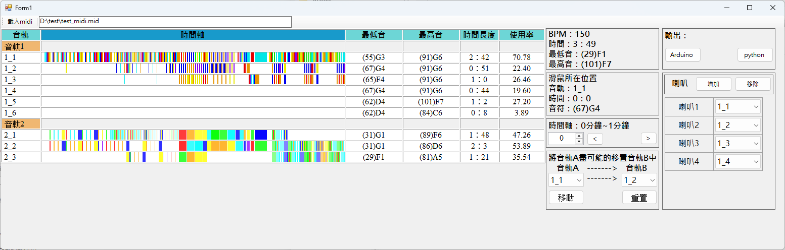

# 多蜂鳴器演奏用 MIDI 轉換器

這個 Windows 桌面工具把 MIDI 樂曲轉成可供多個蜂鳴器同步演奏的資料。載入 MIDI 後，工具會把同一音軌中同時響起的音符拆成不同聲部。你可以在時間軸上檢查、調整音符，再指定每個蜂鳴器要播放哪個聲部。

轉換結果可匯出成 Arduino 標頭檔（`.h`）或 Python 資料檔（`.py`）。檔案記錄曲速（BPM）、每個蜂鳴器的音符與休止，以及每段的時值，讓 ESP32 上的 Arduino 程式或 Python 播放程式能依照這些資料重現各聲部的演奏時序。



## 建置與執行

- 在 Windows 上使用 Visual Studio，安裝「.NET 桌面開發」工作負載及 .NET Framework 4.8 Targeting Pack。也可透過 Developer Pack 取得參考組件。[Microsoft 的 .NET Framework 安裝指南](https://learn.microsoft.com/zh-tw/dotnet/framework/install/guide-for-developers)
- 使用支援 `.slnx` 的 Visual Studio 開啟 [midi轉換器Csh.slnx](midi轉換器Csh.slnx)，按 **F5** 建置並執行。透過命令列建置時，可在 Visual Studio 的 Developer PowerShell 切換到專案根目錄並執行下列指令。

```powershell
MSBuild.exe ".\midi轉換器Csh.csproj" /t:Build /p:Configuration=Release
& ".\bin\Release\midi轉換器Csh.exe"
```

若已有建置好的執行檔，可在具備 .NET Framework 4.8 或相容更新版本的 Windows 上直接執行。

## 使用方式

1. 按 **載入midi** 選取檔案。檔案選擇器提供 `.mid`、`.midi` 和 `.kar` 篩選。
2. 查看 BPM、全曲時間和音域。時間軸以分鐘分頁，按 **<** 或 **>** 切換，滑鼠移到色條上可查看該位置的時間與音符。每列的編號代表「音軌_聲部」，例如 `2_1` 是第 2 個顯示音軌的第 1 個聲部。**時間長度** 是該聲部有音符的累計時間，**使用率** 是這段時間佔全曲時間的百分比。
3. 如需重新分配音符，在左側下拉選單選來源，在右側選目標。按 **移動** 會把來源的音符移到目標同一時間的空白區段，重疊的部分留在來源。按 **重置** 可恢復載入時的音符分配。
4. 在 **喇叭** 區用 **增加** 或 **移除** 調整輸出數量，並用每個喇叭的下拉選單指定一個聲部。**移除** 會刪除最後一組設定，至少保留喇叭 1。
5. 按 **Arduino** 或 **python** 匯出。儲存時請指定副檔名 `.h` 或 `.py`，以便在播放專案中引用。

請使用以每四分音符的 tick 數（PPQN）計時的 MIDI 檔。檔案需包含 Set Tempo 事件與音符，音符編號須在 0–119 之間。

## 匯出資料

| 欄位 | 內容 |
| --- | --- |
| `BPM` | 檔案中第一個 Set Tempo 事件換算後的整數 BPM，以浮點數形式輸出。 |
| `spk1`、`spk2` 等 | 每個喇叭的音符序列。每個元素對應一個時間片段，數值是 MIDI 音符編號，`-1` 代表休止。 |
| `rhythm` | 所有喇叭共用的時值序列，以第一個速度的四分音符長度為單位，輸出至小數點後四位。 |
| `spk` | 依喇叭順序收集各音符序列的陣列或清單。 |

以下是 Arduino 匯出的 `intone.h` 範例，包含兩個聲部和三個時間片段。在 120 BPM 下，`rhythm[1]` 的 `0.5000` 對應 0.25 秒，這段時間喇叭 1 休止，喇叭 2 使用 MIDI 音符 67。

```cpp
double BPM = 120.0;

const static PROGMEM int spk1[]= {60,-1,64};
const static PROGMEM int spk2[]= {-1,67,69};

const static PROGMEM double rhythm[] = {1.0000,0.5000,0.5000};
const static int* const PROGMEM spk[] = { spk1,spk2};
```

Arduino 標頭檔以 `PROGMEM` 宣告音符與時值陣列，需要在有定義 `PROGMEM` 的 Arduino 環境中引用。播放端負責指定腳位或音訊輸出，並把 MIDI 音符編號轉成頻率，依 `rhythm` 安排播放時序。

## Wokwi 播放模擬

此範例使用 ESP32 DevKit v1，四個蜂鳴器依序接到 GPIO 19、18、5、17（板上標示 TX2），綠色按鈕接到 GPIO 34。開啟專案後，按 **Start the simulation**，再按綠色按鈕開始或暫停播放。[在 Wokwi 開啟 ESP32 四聲部播放範例](https://wokwi.com/projects/350806693975687763)

`sketch.ino` 內建曲目資料，會把 MIDI 音符編號查表轉成頻率，遇到 `-1` 時讓對應的蜂鳴器靜音。每個時間片段的長度為 `rhythm[i] * 60000 / BPM` 毫秒。

要播放自己的轉換結果，可將匯出的 `intone.h` 加入此範例的副本，並把 `sketch.ino` 內原有的 `BPM`、`spk1` 至 `spk4`、`rhythm` 與 `spk` 定義換成 `#include "intone.h"`。讓腳位陣列 `spkt` 的元素數與 `spk` 的聲部數相同。若使用上面的兩聲部範例，將 `spkt` 設為 `{19, 18}`。

## 程式結構

| 檔案 | 職責 |
| --- | --- |
| [Program.cs](Program.cs) | 啟動 Windows Forms 並開啟主視窗。 |
| [Form1.cs](Form1.cs)、[Form1.Designer.cs](Form1.Designer.cs) | 檔案選擇、時間軸與統計、音符移動、喇叭設定及匯出。 |
| [mus.cs](mus.cs) | 讀取 MIDI 標頭與音軌，將各聲部對齊到共用時間軸並換算時值。 |
| [mus.mfn.cs](mus.mfn.cs) | 解讀 MIDI 事件、配對 Note On／Note Off，並擷取速度變更。 |
| [mus.pm.cs](mus.pm.cs) | 定義解析用的音符、速度及時間資料。 |
